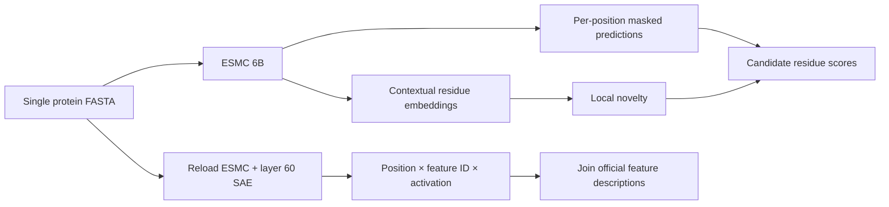
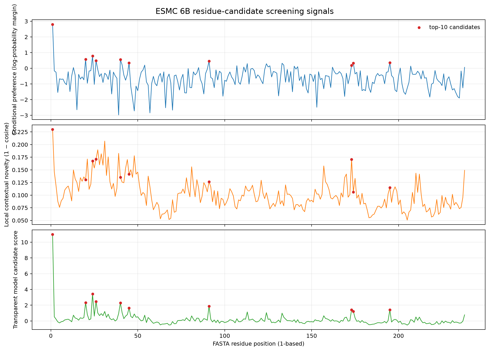

# ESMC + SAE Protein Residue Analysis Demo

Language: **English** | [简体中文](README.zh-CN.md)

A local analysis pipeline demonstrated on GFP: given a single protein FASTA sequence, ESMC 6B produces contextual residue embeddings and per-position masked scores, while a pretrained sparse autoencoder (SAE) extracts active features for each residue. This is a research demo for exploring structural and functional signals in the model.

## What it does



- **Residue representations:** export the final hidden state by default, giving `H ∈ R^(L×2560)`, together with a mean-pooled vector and token mapping.
- **Candidate ranking:** mask each position, calculate the log-probability margin between the observed residue and the best alternative, and combine it with local embedding novelty.
- **SAE interpretation:** read layer 60 representations, retain 64 of 16,384 features per residue, and join Biohub's description table by feature ID.
- **Auditable outputs:** save complete CSV and NPZ files, model revisions, dependency versions, GPU snapshots, and run arguments. Each run gets a new directory.

There are two different coordinates: residue positions use 1-based FASTA numbering, while SAE feature IDs index the official feature dictionary. One residue can activate multiple features, and one feature can occur at multiple residues or in multiple proteins. Descriptions provide semantic clues about properties; activation values are not calibrated biological confidence scores.

## Inspect the included demo: no GPU required

The repository includes the complete GFP example from 2026-09-05 UTC. With Python 3.12, run:

```bash
python scripts/verify_demo.py
```

This command uses only the Python standard library. It checks sequence numbering, all 238 scoring rows, the scoring formula, NPZ shapes, SAE sparsity, and the source-script hash, then prints the checks and the top five sites.

Browse the outputs directly:

- [All GFP position scores](examples/gfp/candidate_sites_all.csv)
- [Top 10 sites](examples/gfp/top_candidate_sites.csv)
- [Residue-level SAE activations](examples/gfp/sae_residue_activations.csv)
- [Feature descriptions and active positions](examples/gfp/sae_feature_summary.csv)
- [Corrected structural audit](docs/GFP_AUDIT.md)
- [34-slide Chinese PowerPoint](presentation/output/ESMC_6B_SAE_GFP_20260906.pptx) and [Chinese speaker notes](presentation/notes/total.md)

The presentation, speaker notes, and slide-specific teaching materials remain in Chinese. Project documentation is available in both languages through the links at the top of each document.



## Results from this GFP run

| Item | Completed example result |
|---|---|
| Input | UniProt P42212 GFP, 238 aa |
| Residue representations | `238×2560`, exported state 80; saved as FP16 |
| Masked scan | 238 positions, batch size 1 |
| SAE | Layer 60, 16,384 features, TopK 64 |
| Activation export | 15,232 records, 1,134 active feature IDs |
| Top two sites | M1: 10.985227; G24: 3.422573 |
| Known chromophore control | S65, Y66, and G67 rank 225, 223, and 211, respectively |

For example, representative G24 features F13094 and F9528 have descriptions related to β-strand connections and loops/turns, suggesting local structural hypotheses. The current ranking uses only masked preference and novelty; SAE provides interpretation after ranking.

The chromophore sites rank near the bottom in this run, so the combined score still needs functional controls and numerical calibration. The evidence supports completion of the pipeline and observations under this implementation; functional or mechanistic conclusions need independent validation. 1EMA is an S65T/Q80R variant: its merged CRO record corresponds to input positions 65–67, and subsequent polymer labels are two less than input positions. See the audit for the complete mapping.

## Run your own sequence

You need Python 3.12, an NVIDIA CUDA GPU supporting FP16/BF16, sufficient memory, and storage for the model downloads. The included GFP example ran on an RTX 5080 Laptop 16 GB using BF16 and SDPA. Recorded GPU memory values are snapshots; requirements for longer sequences need to be measured.

Create a separate environment and install dependencies from the repository root:

```bash
python -m venv .venv
```

Windows PowerShell:

```powershell
.\.venv\Scripts\Activate.ps1
python -m pip install --upgrade pip
python -m pip install -r requirements.txt
python pipeline/run_esmc_site_pipeline.py --smoke-test --sae
```

Linux:

```bash
source .venv/bin/activate
python -m pip install --upgrade pip
python -m pip install -r requirements.txt
python pipeline/run_esmc_site_pipeline.py --smoke-test --sae
```

For a single FASTA sequence using standard amino acids:

```bash
python pipeline/run_esmc_site_pipeline.py --fasta path/to/protein.fasta --sae
```

The default cache is `hf_cache/` in the repository; new results go to `runs/run_<UTC_timestamp>_<sequence_name>/`. Use `--help` to inspect run options. Model files are downloaded from Hugging Face and require substantial disk space.

To use the same model revisions as the included example:

```bash
python pipeline/run_esmc_site_pipeline.py --smoke-test --sae --model-revision ffd268e4c72c4c9757066cd74e9a793bf7b24771 --sae-revision 99752fe6e4d25fbb26f887db2d9225e7a577da73
```

`requirements.txt` pins the direct dependencies and Biohub ESM source commit used in the completed run. See the [run metadata](examples/gfp/run_metadata.json) for the full observed environment. The runner uses legacy `biohub/esmc-6b-2024-12` weights with an explicit key adapter; a numerical parity baseline against matched official inference has not yet been established.

## Scoring formula

```text
margin_i = log p(observed residue | rest of sequence) − max log p(other 19 standard amino acids | rest of sequence)
novelty_i = 1 − cos(h_i, mean embedding of up to 5 neighbors on each side, excluding i)
score_i = 0.7 × robust_z(max(margin_i, 0)) + 0.3 × robust_z(novelty_i)
robust_z(u) = (u − median(u)) / (1.4826 × MAD(u))
```

When MAD is near zero, the implementation falls back to standard deviation; if both are near zero, it returns a zero vector. Weights and the neighborhood window are configurable. Ranking compares positions within the current protein. In this GFP example, 210 negative margins were clipped to zero, so their relative ordering depends entirely on novelty. SAE activations are exported as raw values; per-feature max/IDF scaling is disabled by default.

## Code and repository layout

```text
pipeline/                 Completed-run ESMC + SAE runner and GFP input
scripts/verify_demo.py     Standard-library example validator
examples/gfp/             Actual run outputs and metadata
docs/GFP_AUDIT.md          Numbering, scoring, and feature interpretation audit
audit/                    Evidence generation script and 1EMA reference data
presentation/src/         PowerPoint build, verification, and packaging scripts
presentation/data/        Structured slide evidence and speaker-note JSON
presentation/notes/       Chinese speaker notes for all 34 slides
presentation/output/      Generated PowerPoint, notes, and quality reports
```

The inference runner preserves the exact bytes of the historical run version. Presentation and evidence-generation scripts are archived in full and still contain local paths. Rebuilding the presentation requires the original Codex Artifact Tool runtime and path adaptation; see the [presentation source notes](presentation/README.md). The generated PowerPoint can be downloaded directly.

## Upstream sources

- [Biohub ESM source](https://github.com/Biohub/esm), run commit `bf343ba264b650dff7a073643725f9aaa1fdbe8d`
- [Legacy ESMC 6B weights](https://huggingface.co/biohub/esmc-6b-2024-12)
- [Layer 60 SAE](https://huggingface.co/biohub/ESMC-6B-sae-layer60-k64-codebook16384)
- [Official SAE feature descriptions](https://huggingface.co/datasets/biohub/ESMC-SAE-Features), generated by agents
- [UniProt P42212](https://www.uniprot.org/uniprotkb/P42212) and [PDB 1EMA](https://www.rcsb.org/structure/1EMA)

Licenses and usage conditions for models, data, and third-party dependencies are governed by their respective upstream projects.
