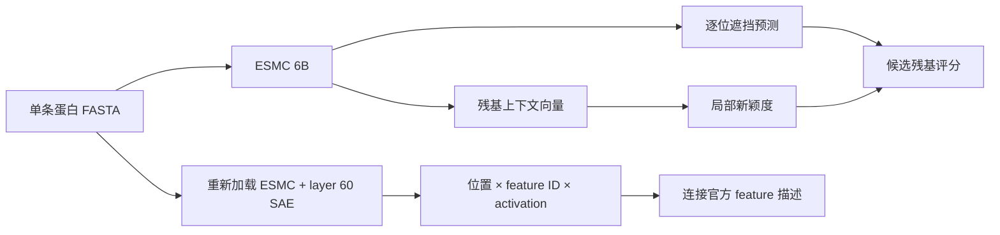

# ESMC + SAE 蛋白残基分析 Demo

语言：[English](README.md) | **简体中文**

这是一个已经在 GFP 上跑通的本地分析 pipeline：输入一条蛋白质 FASTA，使用 ESMC 6B 生成残基上下文向量、逐位遮挡评分，并用预训练 SAE 读取每个残基激活的稀疏特征。项目用于查看模型中的结构与功能线索，当前定位是研究 demo。

## 它做什么



- **残基表示**：默认导出最后的 hidden state，得到 `H ∈ R^(L×2560)`，同时保存平均池化向量和 token 映射。
- **候选排名**：逐位遮挡，计算模型对原残基相对于最佳替代残基的 log-probability margin，再与局部向量新颖度组合。
- **SAE 解释**：读取第 60 层表示，在 16,384 个特征中每个残基保留 64 项；按 feature ID 连接 Biohub 的描述表。
- **可核查输出**：保存完整 CSV、NPZ、模型修订、依赖版本、GPU 状态和运行参数。每次运行使用新目录。

这里有两套坐标：蛋白残基位置是 1-based FASTA 编号，SAE feature ID 是官方字典索引。一个残基可以激活多个特征，一个特征也可以出现在多个残基或蛋白中。特征描述提供 property 的语义线索，激活值本身没有被校准成生物学置信度。

## 先看现成 Demo：无需 GPU

仓库包含 2026-09-05 UTC 的完整 GFP 示例。使用 Python 3.12 执行：

```bash
python scripts/verify_demo.py
```

这个命令仅用 Python 标准库，检查序列编号、238 行评分、评分公式、NPZ 形状、SAE 稀疏度和源脚本哈希。运行后打印检查结果和前五名。

可以直接查看：

- [GFP 全位置评分](examples/gfp/candidate_sites_all.csv)
- [Top10](examples/gfp/top_candidate_sites.csv)
- [残基 SAE 激活](examples/gfp/sae_residue_activations.csv)
- [特征描述与活跃位置](examples/gfp/sae_feature_summary.csv)
- [修正后的结构审计](docs/GFP_AUDIT.zh-CN.md)
- [34 页中文 PPT](presentation/output/ESMC_6B_SAE_GFP_20260906.pptx) 与 [中文讲稿](presentation/notes/total.md)

项目说明提供中英文两版，可通过各文档顶部链接切换。PPT、讲稿及课件专用教学材料继续保留中文。


## 本次 GFP 结果

| 项目 | 已完成的示例结果 |
|---|---|
| 输入 | UniProt P42212 GFP，238 aa |
| 残基表示 | `238×2560`，导出 state 80；FP16 保存 |
| 遮挡扫描 | 238 个位置，batch size 1 |
| SAE | layer 60，16,384 features，TopK 64 |
| 激活导出 | 15,232 条记录，1,134 个活跃 feature ID |
| 排名前两位 | M1：10.985227；G24：3.422573 |
| 已知发色团对照 | S65、Y66、G67 的 rank 分别为 225、223、211 |

例如 G24 的代表性特征 F13094 和 F9528 涉及 β 链连接、loop/turn 语义，可以据此提出局部结构假设。当前排名只使用遮挡偏好与新颖度；SAE 在排名后提供解释。

发色团位点在本次排名后段，说明这个组合分数仍需要功能参照和数值校准。当前证据支持流程完成及该实现下的观察，功能或机制结论需要独立验证。1EMA 是 S65T/Q80R 变体：其 CRO 合并记录对应输入 65–67 位，后续 polymer label 比输入编号小 2；完整映射见审计文档。

## 自己跑一条序列

需要 Python 3.12、支持 FP16/BF16 的 NVIDIA CUDA GPU、足够的内存及模型下载空间。现有 GFP 示例在 RTX 5080 Laptop 16 GB、BF16、SDPA 下完成；显存记录是采样点，长序列的需求需要实际测量。

新建独立环境，在仓库根目录安装依赖：

```bash
python -m venv .venv
```

Windows PowerShell：

```powershell
.\.venv\Scripts\Activate.ps1
python -m pip install --upgrade pip
python -m pip install -r requirements.txt
python pipeline/run_esmc_site_pipeline.py --smoke-test --sae
```

Linux：

```bash
source .venv/bin/activate
python -m pip install --upgrade pip
python -m pip install -r requirements.txt
python pipeline/run_esmc_site_pipeline.py --smoke-test --sae
```

处理自己的标准氨基酸单条 FASTA：

```bash
python pipeline/run_esmc_site_pipeline.py --fasta path/to/protein.fasta --sae
```

默认缓存放在仓库的 `hf_cache/`，新结果写入 `runs/run_<UTC时间>_<序列名称>/`。运行参数可通过 `--help` 查看。模型仓库需要较大的下载空间，实际数据由 Hugging Face 获取。

严格复现示例的模型修订时：

```bash
python pipeline/run_esmc_site_pipeline.py --smoke-test --sae --model-revision ffd268e4c72c4c9757066cd74e9a793bf7b24771 --sae-revision 99752fe6e4d25fbb26f887db2d9225e7a577da73
```

`requirements.txt` 固定了已运行环境的直接依赖与 Biohub ESM 源码提交。完整观测环境见 [运行 metadata](examples/gfp/run_metadata.json)。当前 runner 使用旧版 `biohub/esmc-6b-2024-12` 权重和显式 key adapter；官方匹配推理的数值一致性基线仍待建立。

## 评分公式

```text
margin_i = log p(原残基 | 其余序列) − max log p(其他19种标准氨基酸 | 其余序列)
novelty_i = 1 − cos(h_i, 左右各5位邻居的平均向量)
score_i = 0.7 × robust_z(max(margin_i, 0)) + 0.3 × robust_z(novelty_i)
robust_z(u) = (u − median(u)) / (1.4826 × MAD(u))
```

MAD 接近零时回退到标准差，两者均接近零时输出零向量。权重和窗口可设置，排序范围是当前蛋白内的位置。在这个 GFP 示例中，210 个负 margin 被裁剪为 0，它们之间的次序完全由新颖度决定。SAE 激活按 raw 数值导出，逐 feature max/IDF 标度默认关闭。

## 代码与目录

```text
pipeline/                 已运行的 ESMC + SAE 主脚本与 GFP 输入
scripts/verify_demo.py     标准库示例检查器
examples/gfp/             真实运行结果与 metadata
docs/GFP_AUDIT.md          编号、评分与特征解释审计
audit/                    证据生成脚本及 1EMA 参照数据
presentation/src/         PPT 构建、检查和打包代码
presentation/data/        课件使用的结构化证据与讲稿 JSON
presentation/notes/       34 页中文讲稿
presentation/output/      已生成的 PPT、讲稿及质量报告
```

推理主脚本保留了历史运行版本的原始字节。课件和证据生成脚本作为当时的完整源码归档，仍含本机路径；重新构建课件需要原来的 Codex Artifact Tool 运行时及路径适配，详情见 [课件源码说明](presentation/README.zh-CN.md)。预生成的 PPT 可以直接下载查看。

## 上游来源

- [Biohub ESM 源码](https://github.com/Biohub/esm)，已运行提交 `bf343ba264b650dff7a073643725f9aaa1fdbe8d`
- [历史 ESMC 6B 权重](https://huggingface.co/biohub/esmc-6b-2024-12)
- [Layer 60 SAE](https://huggingface.co/biohub/ESMC-6B-sae-layer60-k64-codebook16384)
- [官方 SAE 特征描述](https://huggingface.co/datasets/biohub/ESMC-SAE-Features)，描述由 agent 生成
- [UniProt P42212](https://www.uniprot.org/uniprotkb/P42212) 与 [PDB 1EMA](https://www.rcsb.org/structure/1EMA)

模型、数据和第三方依赖各自的许可证与使用条件由对应上游项目规定。
